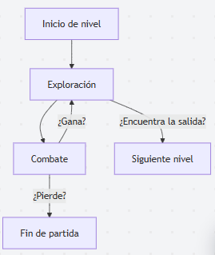
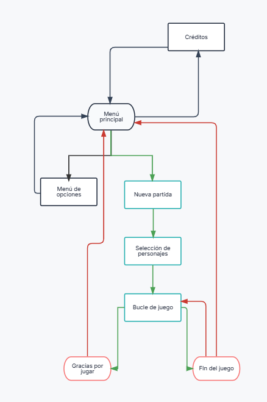

# Galician Odyssey - Documento de diseño (GDD)

## 1. Ficha del juego

| | |
|---|---|
| Título | Galician Odyssey |
| Autor/a | Rubén Hernández |
| Género | Dungeon RPG en primera persona / Roguelike |
| 2D / 3D | 3D |
| Plataformas | Windows |
| Versión de Unity y pipeline | Unity 6 - Built-in Render |
| Público objetivo y PEGI | PEGI 12 |
| Duración de una partida | De 10 minutos (1 nivel) a una hora (6 niveles) |
| Repositorio | https://github.com/rher02/GalicianOdyssey/ |
| Página de itch.io | |

## 2. Concepto

### Resumen
Un RPG en primera persona en el que exploras mini-mazmorras inspiradas en localidades gallegas, mientras que luchas contra enemigos inspirados en el folklore gallego para que los peregrinos puedan hacer el Camino de Santiago.

### Pilares de diseño
- Movimiento en casillas.
- Niveles pequeños, pero con varios caminos a explorar.
- Nuevas mecánicas de exploración cada pocos niveles.

### Referencias
- [Etrian Odyssey](https://en.wikipedia.org/wiki/Etrian_Odyssey_(video_game)): Creación de personajes basados en clases y inspiración para el nombre y estilo artístico del juego.
  

- [Shin Megami Tensei: Strange Journey](https://en.wikipedia.org/wiki/Shin_Megami_Tensei:_Strange_Journey): Movimiento y exploración de los mapas.
  

### Qué lo hace diferente
- Mapas más concisos y simples para que la exploración sea más amena y poder hacer partidas más cortas.
- Mayor simplicidad de mecánicas para jugadores menos experimentados en los combates por turnos.
- Requisitos para poder acabar cada nivel.
  
## 3. Historia y ambientación
Un grupo de aventureros gallegos intentarán acabar con los monstruos que moran en pueblos y ciudades gallegas para que los peregrinos puedan hacer el Camino de Santiago.

Los protagonistas son diferentes personajes a elegir, sin historia, simples aventureros.

La historia se cuenta a través de cinemáticas al inicio de cada nivel y al final.

## 4. Jugabilidad

### Objetivo
Llegar al final del camino y eliminar al monstruo final.

### Bucle de juego

### Condiciones de victoria y derrota
- Victoria: Cumple los requisitos de todos los niveles.
- Derrota: La vida de los protagonistas baja a cero.

### Progresión
Al avanzar en el juego, tanto los enemigos como los protagonistas consiguen mejores ataques para hacer el combate más complejo.

## 5. Mecánicas
| Mecánica | Descripción | Donde aparece |
|----------|-------------|---------------|
| Habilidad nueva | El usuario elige una habilidad extra para un protagonista. | Al finalizar cada combate. |
| Objeto recogible | Objeto escondido en el mapa requerido para completar en nivel. | Triacastela y Arzúa |
| Muro falso | Muro con textura distinta que se puede atravesar, el cual no se muestra como muro en el minimapa. | Portomarín y Santiago |
| Casilla de teletransporte | Teletransporta al grupo al inicio del nivel | Palas de Rei |

## 6. Controles

| Acción | Teclado | Mando |
|--------|---------|-------|
| Ir hacia delante | `W` o `Flecha arriba` | Cruceta arriba |
| Ir hacia atrás | `S` o `Flecha abajo` | Cruceta abajo |
| Rotar hacia la izquierda | `A` o `Flecha izquierda` | Cruceta izquierda |
| Rotar hacia la derecha | `D` o `Flecha derecha` | Cruceta derecha |
| Ir hacia la izquierda | `Q` | Botón `L1` o Gatillo `izquierda` |
| Ir hacia la derecha | `E` | Botón `R1` o Gatillo `derecha` |
| Interactuar | `Intro` | Botón `A` |
| Volver al menú anterior | `Escape` | Botón `B` |
| Menú del equipo | `Espacio` | Botón `Start` |

## 7. Niveles

| Nivel | Objetivo del nivel | Mecánica | Enemigos | Mapa | Escena de Unity | Duración |
| --- | --- | --- | --- | --- | --- | --- |
| O Cebreiro | Derrotar a 3 grupos de enemigos | `Ninguna` |  | --- | --- | 5 minutos |
| Triacastela | Buscar 1 objeto perdido | `Objeto recogible` |  | --- | --- | 5 - 10 minutos |
| Sarria | Derrotar a un enemigo poderoso | `Ninguna` |  | --- | --- | 5 - 10 minutos |
| Portomarín | Escapar del laberinto | `Muro falso` |  | --- | --- | 5 - 10 minutos |
| Palas de Rei | Escapar del laberinto | `Casilla de teletransporte` |  | --- | --- | 5 - 15 minutos |
| Melide | Derrotar a un enemigo poderoso | `Ninguna` |  | --- | --- | 5 - 10 minutos |
| Arzúa | Buscar 3 objetos perdidos | `Objeto recogible` |  | --- | --- | 5 - 10 minutos |
| Santiago de Compostela | Derrotar al enemigo final | `Muro falso` |  | --- | --- | 10 - 20 minutos |
| Finisterre | Derrotar al enemigo secreto | `Ninguna` |  | --- | --- | 5 - 10 minutos |

## 8. Personajes y enemigos
### Personajes disponibles
#### Herrero
Personaje con baja cantidad de vida, pero gran ataque. Centrado en atacar con sus propias armas.
#### Caballero
Personaje con mucha defensa y ataque decente. Defiende al resto del grupo.
#### Gaiteiro
Personaje con muy bajo ataque. Centrado en subir las estadísticas del grupo.
#### Agricultor
Personaje con alta cantidad de vida y bajo ataque. Cura al grupo lanzándole lo que coseche.
#### Meiga
Personaje con alta evasión y poca vida. Revive a los miembros debilitados del grupo y conjura a los enemigos.

## 9. Interfaz y flujo de pantallas

### Diagrama de flujo

### HUD

### Menús

## 10. Dirección de arte
Estilo dibujado a mano, con modelos 3D low-poly. Resolución de sprites variable.

### Paleta de colores

### Tipografías

### Tablero de referencias (moodboard)

### Justificación de la coherencia
Los recursos (sprites, modelos, música, etc.) han sido hechos por mí con la paleta de colores mostrada anteriormente.
Los elementos que no encajaban han sido modificados hasta adecuarse al estilo.

## 11. Sonido y música
- Estilo rock con instrumentos del folklore gallego, mezclando así el ambiente medieval con algo más moderno.

### Lista de pistas de música

### Lista de efectos de sonido

## 12. Efectos visuales y game feel
- Cortina vertical al entrar en combate o entrar a un nivel.
- Degradado a negro al acabar el combate o perder.
- Iluminación
- Cámara fija desde el punto de vista del grupo.
- Partículas al atacar (diferentes con cada enemigo), sprites animados para mayor inmersión.

## 13. Recursos de terceros
No se han usado assets de terceros para ningún apartado del juego. 
Todos los assets han sido creados por mí.

## 14. Declaración de uso de IA
No se ha usado ninguna clase de IA en este proyecto, ni en el código ni en recursos gráficos o sonoros.

## 15. Aspectos técnicos

## 16. Diario de desarrollo

#### 2026-10-5
Se ha añadido un mapa de prueba para probar el movimiento en los niveles. Ha habido problemas con las texturas al importar el primer modelo 3D, pero se ha solucionado con facilidad al aplicar las texturas manualmente.

#### 2026-10-16
Se ha añadido más detalles al mapa de prueba, mejorando así la estética del nivel.
Se ha añadido una pantalla de selección de personaje para pruebas.

## 17. Pruebas con jugadores

## 18. Postmortem
